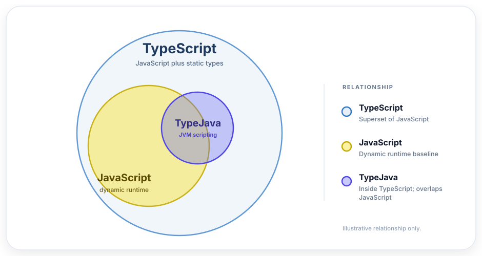

# TypeJava

Run a TypeScript subset directly on the JVM

<p align="center">
  
</p>

## Who it is for

- You need a scripting solution; use cases might include:
  * Rule engines
  * Large-volume ad-hoc classifiers
  * A small but highly dynamic configuration portion of your main application
- You need it to go brr
- You want your users to have a basic but functional IDE experience
- You don't want to add a Christmas tree of dependencies
- Simple, secure language: no dynamic classpath loading, no reflection

It powers the notification classifier at [kilonode.cc](https://kilonode.cc/), easily processing bursts of thousands of logs per second!

## At a glance

- TypeScript-like syntax with explicit types and required semicolons.
- Nominal object types, explicit `T | null` nullability, and flow-based null narrowing.
- Functions, object methods, `while` loops, and standard `TjArray` / `TjMap` collections.
- Compile once, create isolated program instances, and call exported functions from Java.
- Ambient TypeScript declarations for editor tooling and `.d.ts` consumers.
- Fail-fast compilation: the first lexical, syntax, or type error stops the compile.

```ts
type Greeting = {
  readonly name: string;
};

function greet(greeting: Greeting): string {
  return "Hello, " + greeting.name;
};

console.log(greet({ name: "Ada" }));
```

## Install

Java 21 is required. TypeJava is published to GitHub Packages as `cc.kilonode:typejava`, and release
jars are available from [GitHub Releases](https://github.com/dawidcxx/typejava/releases).

GitHub Packages requires authentication even for public packages. Create a classic personal access
token with the `read:packages` scope and use your GitHub username as the username.

### Gradle

Add the repository and dependency to your build:

```kotlin
repositories {
    maven {
        url = uri("https://maven.pkg.github.com/dawidcxx/typejava")
        credentials {
            username = System.getenv("GITHUB_ACTOR")
            password = System.getenv("GITHUB_TOKEN")
        }
    }
}

dependencies {
    implementation("cc.kilonode:typejava:0.5.0")
}
```

Export the credentials in your shell or CI environment:

```bash
export GITHUB_ACTOR=your-github-username
export GITHUB_TOKEN=ghp_your_read_packages_token
```

### CLI

Download the self-contained CLI jar and run a script:

```bash
java -jar typejava-0.5.0-all.jar script.tj
```

## Get started

Learn the language in the [TypeJava guide](TJ_GUIDE.md). It assumes some TypeScript familiarity and
covers the type system, objects, nulls, collections, and the parts of TypeScript that do not exist
here.

Use TypeJava from Java with the [implementor guide](IMPLEMENTATORS_GUIDE.md). It covers compiling
and running scripts, isolated program instances, exported functions, record bindings, custom native
types, and TypeScript declaration generation for Monaco and other editors.

## Performance

On the included log-classification benchmark, TypeJava takes about 1.2x as long as plain Java
(roughly 19% slower) and is still faster than Groovy, Rhino, and BeanShell on the same workload. See
[benchmarks](benchmarks/README.md) for the current numbers and methodology.

## Project docs

- [TypeJava guide](TJ_GUIDE.md) — language syntax and semantics.
- [Implementor guide](IMPLEMENTATORS_GUIDE.md) — Java integration and tooling.
- [Benchmarks](benchmarks/README.md) — workload, methodology, and results.
- [AGENTS.md](AGENTS.md) — build, release, CI, and maintainer notes.
- [LICENSE](LICENSE) — Apache-2.0.

## LLM disclosure

This project was mostly generated using AI tools. There is no major human involvement; it just has to work. AI-generated PRs that add well-tested, TypeScript-compatible features will be accepted.